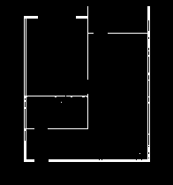
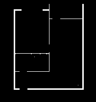
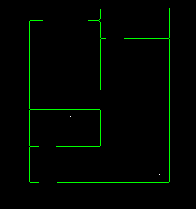
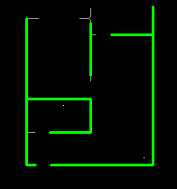
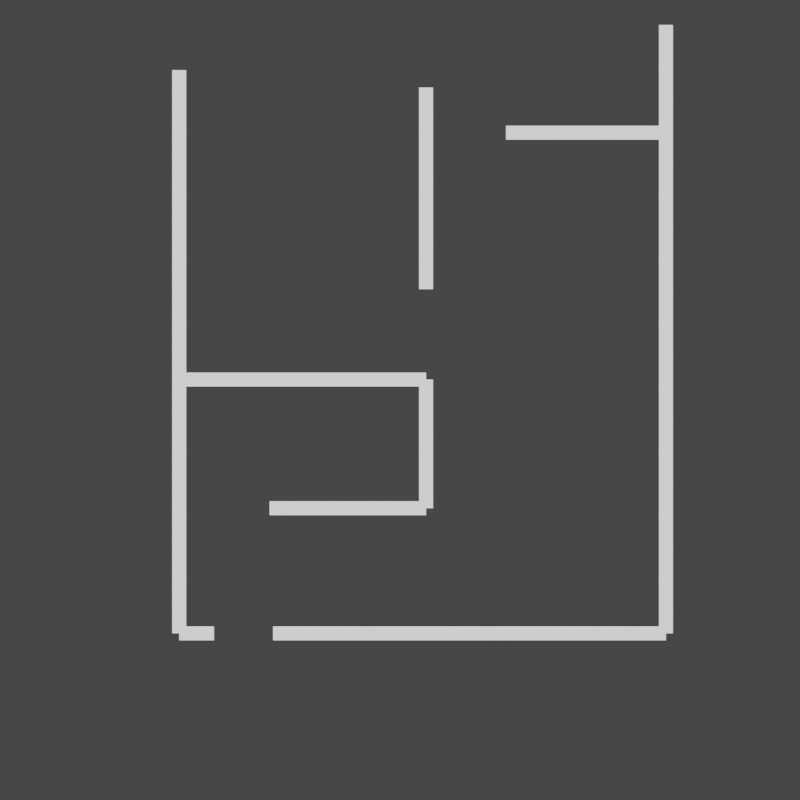

# blueprint2model

Turn a flat, raster floor-plan image into a 3D Blender wall mesh.

The pipeline doesn't use any ML — it's classical computer vision end to
end: threshold the walls into a mask, clean it up with a convolution,
skeletonize it, extract and merge straight wall segments with a Hough
transform ("vector projections" below), re-skeletonize, then place a
wall of a set thickness/height along each merged segment's coordinates
in Blender.

## Every stage, in order

| | | |
|---|---|---|
| **Input** | **Binarized (`step1`)** | **Convolution / gap-fill (`step2`)** |
|  |  |  |
| **Skeleton (`step3`)** | **Vector projections (`step4`)** | **Re-skeletonized (`step5`)** |
|  |  |  |
| **Blender, top-down** | **Blender, angled (`step6`)** | |
|  |  | |

Every image above is real output from an actual run of this exact
code against `examples/simple_blueprint.png`, not mocked up
separately - see `examples/expected_output/`.

## Pipeline

```
image ──► step1 ──► step2 ──► step3 ──► step4 ──► step5 ──► step6 (Blender)
          mask      gap-fill  skeleton  Hough     re-skel   place walls
                     (conv)    (1px)     merge+    (1px)     at coords
                               vectors
```

1. **`step1.py`** — grayscale + threshold → binary wall mask.
2. **`step2.py`** — morphological close (a convolution with a small
   structuring element) to bridge small gaps - door/window crossings,
   anti-aliasing.
3. **`step3.py`** — skeletonize the mask down to a 1px-wide centerline.
4. **`step4.py`** — Hough transform pulls out line segments, extends
   each one slightly to close corner gaps, classifies them as
   horizontal/vertical, and merges collinear segments into whole wall
   vectors. Besides the preview images, this is the stage that writes
   `wall_segments.json` - the actual merged `(x1, y1, x2, y2)` vectors
   stage 6 builds from.
5. **`step5.py`** — re-skeletonize after stage 4 redraws merged walls
   as thick lines, for the 2D preview image. (Stage 6 reads stage 4's
   JSON directly and doesn't depend on this image - see below.)
6. **`step6.py`** — runs inside Blender's embedded Python: loads
   `wall_segments.json`, maps each segment's pixel coordinates to
   Blender world coordinates, and places a wall of a set
   height/thickness along it as a solid mesh.

### Why stage 6 reads JSON instead of the skeleton image

The first version of stage 6 re-derived wall paths by running
`cv2.findContours` + `approxPolyDP` on `final_skeleton.png`. Every 2D
preview image looked correct, but the 3D render kept showing an extra
diagonal wall that didn't exist anywhere in the floor plan. The cause:
`findContours` traces the boundary of a filled region, not a 1px-wide
open line - on a thin skeleton it walks up one side and back down the
other, and `approxPolyDP` simplification could insert a spurious
diagonal shortcut between that "there" and "back" traversal at a
branch point. It never showed up in any flat image, only once extruded
into 3D. Stage 4 already has the exact merged wall vectors in memory,
so stage 6 now reads those from `wall_segments.json` instead of
re-parsing a raster image - no contour tracing, no diagonal artifact,
and one less thing (`cv2` inside Blender) to install.

## Install

```bash
pip install -r requirements.txt
```

Stage 6 needs [Blender](https://www.blender.org/download/). Its bundled
Python is separate from your system Python - `pip install` above does
not reach it, and `pip install bmesh` will never work anywhere (`bpy`
and `bmesh` ship with Blender itself, they aren't on PyPI). Stage 6
itself no longer needs `cv2` at all (see above); stages 1-5 still run
in your regular Python environment via `requirements.txt`.

## Usage

```bash
# Full pipeline: image -> mask -> skeleton -> Blender wall mesh + rendered preview
python pipeline.py examples/simple_blueprint.png

# Just the 2D stages, skip Blender
python pipeline.py examples/simple_blueprint.png --skip-blender

# Blender not on PATH
python pipeline.py examples/simple_blueprint.png --blender "C:\Program Files\Blender Foundation\Blender\blender.exe"
```

All intermediate masks/skeletons/`wall_segments.json` are written to
`output/` (override with `-o/--output-dir`), including a rendered
`preview.png` once Blender runs.

You can also render a preview directly from any skeleton image (as
long as `wall_segments.json` sits next to it) without going through
the full pipeline:

```bash
blender --background --python render_preview.py -- output/final_skeleton.png output/preview.png
blender --background --python render_preview.py -- output/final_skeleton.png output/preview_top.png --top
```

A straight top-down orthographic render looks almost identical to a
flat 2D line diagram, since you can't see wall height from directly
above - that's why `render_preview.py` defaults to an angled camera.
Both are in the gallery above for comparison.

## Limitations

- Wall detection assumes dark, mostly-straight, axis-aligned lines —
  curved walls, colored wall fills, or heavily stylized floor plans
  will need different thresholding/merging parameters (see the
  constants at the top of `step1.py` and `step4.py`).
- Stage 4's merge only handles horizontal/vertical segments; diagonal
  lines are detected but dropped before merging.
- Walls are built per-segment rather than as one continuous shell, so
  corners can have small gaps or overlaps. Not visible at floor-plan
  scale, but worth knowing if you're after CAD-level precision.
- Stage 6 requires a local Blender install and is not automatable
  headlessly without one (`--background` mode works fine, as used by
  `render_preview.py` and `pipeline.py`).

## License

MIT — see [LICENSE](LICENSE).
