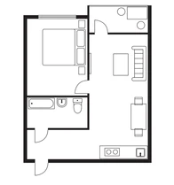
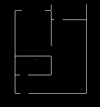
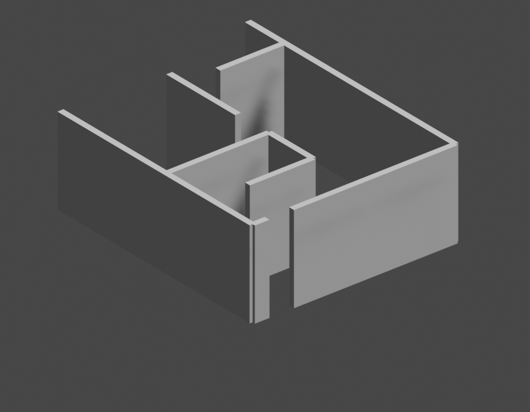

# blueprint2model

Turn a flat, raster floor-plan image into a 3D Blender wall mesh.

The pipeline doesn't use any ML — it's classical computer vision end to
end: threshold the walls into a mask, clean it up with a convolution,
skeletonize it, extract and merge straight wall segments with a Hough
transform, re-skeletonize, then place walls of a set thickness/height
along those coordinates in Blender.

| Input floor plan | Final wall skeleton | 3D result |
|---|---|---|
|  |  |  |

## Pipeline

```
image ──► step1 ──► step2 ──► step3 ──► step4 ──► step5 ──► step6 (Blender)
          mask      gap-fill  skeleton  Hough     re-skel   place walls
                     (conv)    (1px)     merge     (1px)     at coords
```

1. **`step1.py`** — grayscale + threshold → binary wall mask.
2. **`step2.py`** — morphological close (a convolution with a small
   structuring element) to bridge small gaps - door/window crossings,
   anti-aliasing.
3. **`step3.py`** — skeletonize the mask down to a 1px-wide centerline.
4. **`step4.py`** — Hough transform pulls out line segments, extends
   each one slightly to close corner gaps, then merges collinear
   horizontal/vertical segments so everything connects into whole
   walls instead of broken fragments.
5. **`step5.py`** — re-skeletonize after stage 4 redraws merged walls
   as thick lines.
6. **`step6.py`** — runs inside Blender's embedded Python: extracts
   wall paths as contours from the final skeleton, maps pixel
   coordinates to Blender world coordinates, and places a wall of a
   set height/thickness along each path as a solid mesh.

## Install

```bash
pip install -r requirements.txt
```

Stage 6 needs [Blender](https://www.blender.org/download/). Its bundled
Python is separate from your system Python - `pip install` above does
not reach it, and `pip install bmesh` will never work anywhere (`bpy`
and `bmesh` ship with Blender itself, they aren't on PyPI). If stage 6
fails on `import cv2`, install opencv-python into Blender's own Python
(`<blender>/<version>/python/bin/python.exe -m pip install opencv-python`),
or run with `--skip-blender` and open the resulting skeleton in Blender
by hand.

## Usage

```bash
# Full pipeline: image -> mask -> skeleton -> Blender wall mesh + rendered preview
python pipeline.py examples/simple_blueprint.png

# Just the 2D stages, skip Blender
python pipeline.py examples/simple_blueprint.png --skip-blender

# Blender not on PATH
python pipeline.py examples/simple_blueprint.png --blender "C:\Program Files\Blender Foundation\Blender\blender.exe"
```

All intermediate masks/skeletons are written to `output/` (override
with `-o/--output-dir`), including a rendered `preview.png` once
Blender runs. `examples/expected_output/` holds real output from an
actual end-to-end run against `examples/simple_blueprint.png` - every
image there, 2D and 3D, came out of running this exact code, not
mocked up separately.

You can also render a preview directly from any skeleton image without
going through the full pipeline:

```bash
blender --background --python render_preview.py -- output/final_skeleton.png output/preview.png
blender --background --python render_preview.py -- output/final_skeleton.png output/preview_top.png --top
```

## Limitations

- Wall detection assumes dark, mostly-straight, axis-aligned lines —
  curved walls, colored wall fills, or heavily stylized floor plans
  will need different thresholding/merging parameters (see the
  constants at the top of `step1.py` and `step4.py`).
- Stage 4's merge only handles horizontal/vertical segments;
  diagonal walls are detected but dropped. Stage 6's contour
  simplification can still occasionally pick up a short spurious
  diagonal near a skeleton endpoint - visible as a small stray wall
  in the example render above.
- Walls are built per-segment rather than as one continuous shell, so
  corners can have small gaps or overlaps. Not visible at floor-plan
  scale, but worth knowing if you're after CAD-level precision.
- Stage 6 requires a local Blender install and is not automatable
  headlessly without one (`--background` mode works fine, as used by
  `render_preview.py` and `pipeline.py`).

## License

MIT — see [LICENSE](LICENSE).
